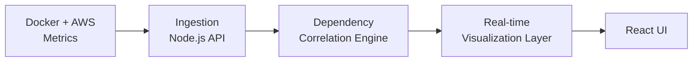

 

---

## 👋 About Me

I design **secure, automated, and observable cloud systems** with a focus on production reliability, DevSecOps, and infrastructure clarity.

| | |
|---|---|
| ☁️ **Cloud** | AWS-native architectures on containers and Kubernetes |
| 🔄 **Delivery** | CI/CD pipelines with built-in security gates |
| 👁️ **Observability** | Monitoring, metrics, and dependency mapping |
| 💸 **Efficiency** | Automation that cuts cloud spend without cutting reliability |
| 🎯 **Now** | Production Kubernetes · AWS cost optimization · growing VizLab into a full observability suite |

---

## 🧰 Tech Stack

<b>🔎 Explore by category (click to expand)</b>

 

| Category | Tools |
|----------|-------|
| ☁️ Cloud |  |
| 📦 Containers |   |
| 🏗️ IaC |  |
| 🔄 CI/CD |   |
| 🌐 Web & Runtime |    |
| 🐧 Systems |   |

---

## 🚀 Featured Product: VizLab

**VizLab** is a DevOps infrastructure visualization platform that turns complex architectures into clear, interactive visual intelligence.

<b>✨ What VizLab enables</b>

 

- Visual mapping of Docker container relationships
- AWS service dependency visualization
- Faster detection of architectural issues
- Real-time view of system flow
- A hands-on environment for DevOps troubleshooting

<b>🏗️ How it's built</b>

 

- Docker and AWS metrics ingestion
- Dependency correlation engine
- Real-time visualization layer
- Fully containerized Linux deployment
- Production MERN architecture

---

## 🛠️ Systems Engineered

| System | What it does | Impact |
|--------|--------------|--------|
| 🔭 **VizLab** | Infrastructure visualization platform | Visibility and faster debugging |
| 💤 **AWS Idle Instance Stopper** | Stops idle non-production instances | **40%** lower non-prod compute cost |
| 🛡️ **DevSecOps CI/CD Pipeline** | Pipeline with automated security gates | Reduced deployment risk |
| 📡 **Uptimely** (SaaS) | Service uptime monitoring | Faster incident detection |

---

## 📊 GitHub Activity

---

## 🎮 Quick Links

<b>📬 How can we work together?</b>

 

- 🏗️ Cloud infrastructure and Kubernetes setup
- 🔐 DevSecOps pipeline design
- 💰 AWS cost optimization reviews
- 📈 Observability and monitoring strategy

👉 [Message me on LinkedIn](https://www.linkedin.com/in/prajwal-athare-a4074628a/) or [send an email](mailto:atharep1703@gmail.com).

<b>💡 Fun fact</b>

 

I treat infrastructure like a product: if it can't be seen, measured, and automated, it isn't finished. That's the idea behind VizLab.

---

<i>Engineering secure, automated, and observable cloud systems.</i>

